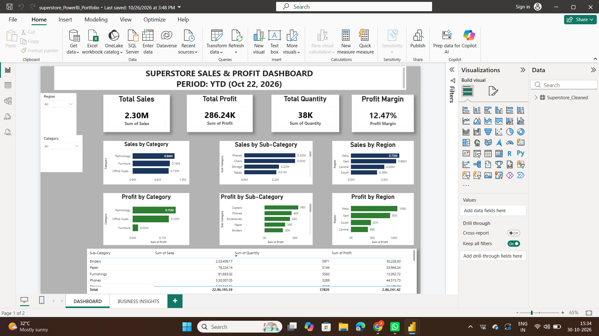

Superstore Data Analyst Portfolio

An end-to-end data analysis project using SQL, Python, and Power BI to analyze sales, profitability, and business performance.

Project Overview

This portfolio demonstrates a complete data analysis workflow, from querying and analyzing data to building an interactive dashboard and presenting business insights.

Tools and Technologies

- SQL Server: Business queries and data analysis
- Python: Pandas, data analysis, and Matplotlib visualizations
- Power BI: Interactive dashboard, KPI cards, charts, and slicers
- Jupyter Notebook: Python analysis and documentation

Project Files

File| Description
"Superstore_portfolio_project.sql"| SQL queries for business analysis
"Superstore_Python_Portfolio.ipynb"| Python analysis and visualizations
"superstore_PowerBI_Portfolio.pbix"| Interactive Power BI dashboard

Key Findings

- Total Sales: Approximately 2.30 million
- Total Profit: Approximately 286,241
- Profit Margin: Approximately 12.47%
- Top Category: Technology led in sales and profit.
- Top Region: West recorded the highest sales.
- Largest Sub-category Loss: Tables.
- Largest State-level Loss: Texas.

Skills Demonstrated

- Data cleaning and exploratory data analysis
- SQL querying and business analysis
- Python data analysis and visualization
- Power BI dashboard development
- KPI reporting and business insights

Project Outcome

This project demonstrates how SQL, Python, and Power BI can be used together to transform sales data into meaningful business insights and support data-driven decisions.
